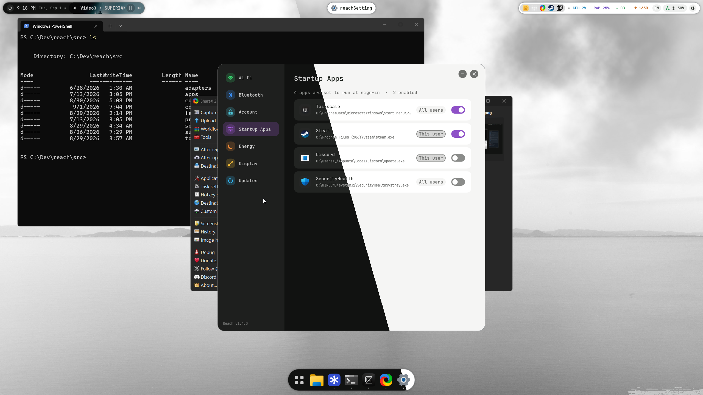
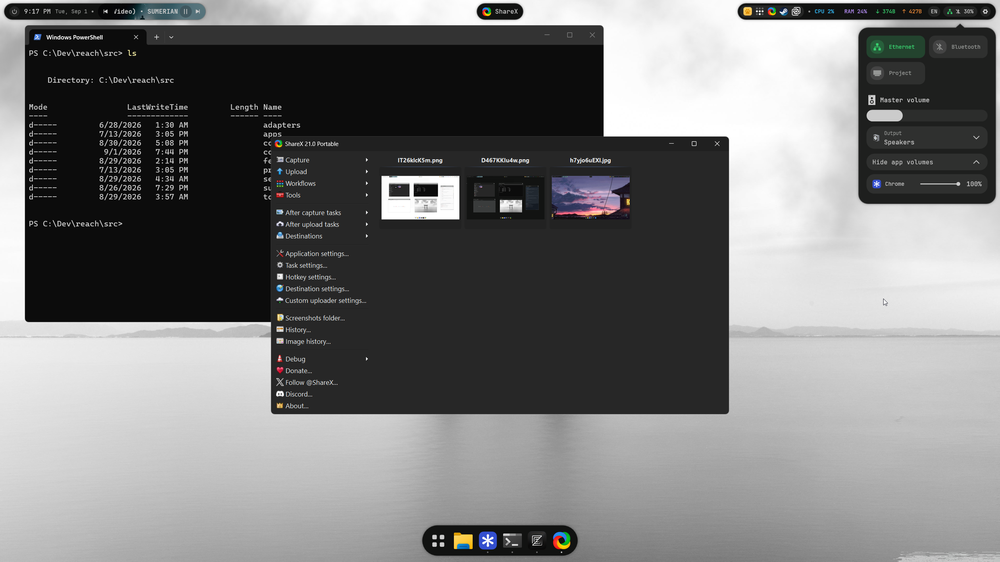
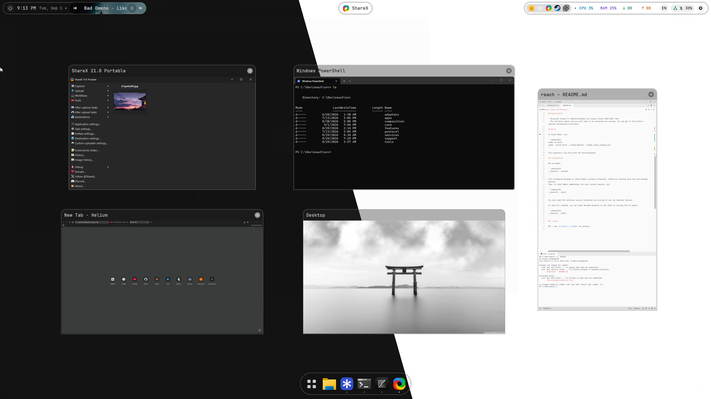
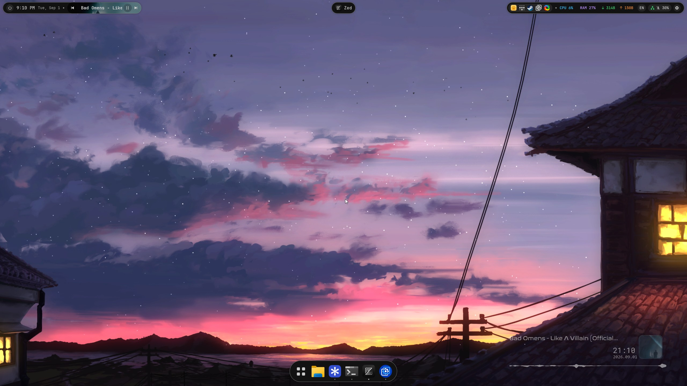

# Reach

> A Direct2d based lightweight Windows 11 desktop replacement.

## Screenshots

<p>


</p>

## Important notice

Reach replaces Windows Explorer, nothing gets deleted, only an entry in the registry gets changed. With reach running a few apps that rely on windows explorer break, most importantly Windows settings. I haven't tested other Windows Store apps as I don't use them.

## Features

- Animated wallpapers through Wallpaper Engine are supported
- Split screen: WIN + arrow keys snaps the focused window, pressing again maximizes it. Works both horizontally and vertically
- Screenshots: WIN + Shift + S lets you select a region of the screen and copies it straight to the clipboard
- Clipboard history supporting text and image previews, items slide into place when the list changes
- Windows security updates can be searched and installed from Reach's settings app
- No distractions
- Clean design with beautiful spring based animations
- Multiple theme, style and font selection options and supports both dark and light themes
- Enhanced features, a lot of quality of life improvements over Windows explorer
- Stage manager with live window thumbnails and smooth animations.
- Three-finger touchpad swipes, also over admin windows: left and right switch apps, up opens Stage, down closes it or shows the desktop
- Configurable screen off, sleep, shutdown and restart timer
- System HUD for hardware keys such as brightness, audio controls and media
- You can run commands directly from the launcher, start by typing ! followed by a command to run it in the windows terminal if its installed
- Most animations are GPU composed
- Auto hide top bar feature
- Topbar displays live system statistics such as network speed, CPU and RAM usage
- Animations run at your screen's max refresh rate and drop to 60fps when battery saver is on
- Keyboard language switch button
- Hovering the top of the screen pulls down the topbar and moves full screen window further below in a smooth animation
- Built to never visibly break: if the GPU driver resets, Reach recovers in place and stays on the GPU. If Reach itself crashes, Windows restarts it right away, and Reach falls back to Explorer only if a version keeps crashing on start
- No idle CPU usage, and very low usage overrall. base memory usage depends on the number of monitors, clipboard size and the number of apps on dock


## Requirements

- Microsoft Visual C++ Redistributable for Visual Studio 2015–2022 (x64)
- The retriever search service will have to be installed and running. You can get it from https://github.com/aymanervn/retriever

## Build

To build Reach, run:

```powershell
cmake -B build
cmake --build build --config Release --target reach_release_zip
```

This produces a zip file with the distributables.

## Installation

Run as admin:

```powershell
./reachctl --install
```

This configures Windows to launch Reach instead of Explorer. Sign out and back in to start Reach, or, if Explorer is already closed, just open `reach.exe`.

You also need the retriever service installed and running to use the launcher feature.

In case of a problem, you can reset Windows Explorer as the shell by running this as admin:

```powershell
./reachctl --reset
```

## License

MIT — see [LICENSE](./LICENSE) for details.
